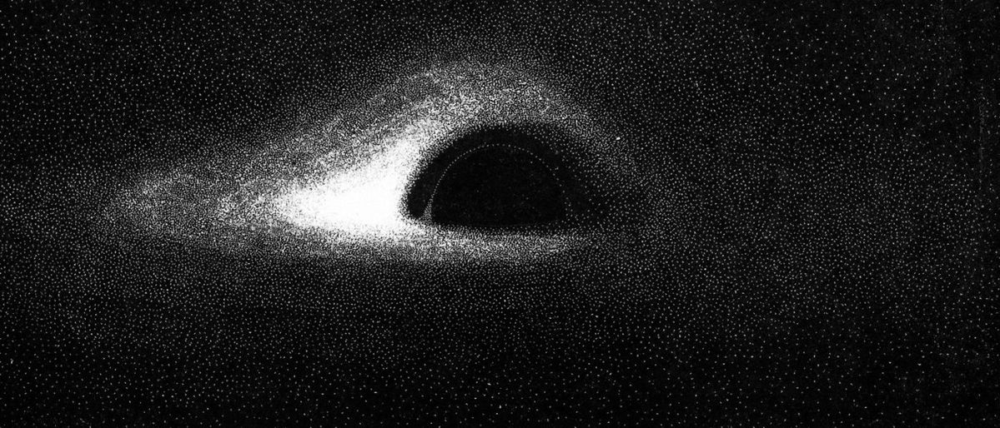

  <h1>Hey, I'm Bvitriak ✦</h1>
  
<strong>Designer &amp; Developer</strong>

  
Born in 2007 · Krasnoyarsk, Russia

  
<a href="https://bvitriak.github.io/bvitriak/">Visit the portfolio ↗</a>

  
<em>Calm interfaces. Precise systems. Thoughtful motion.</em>

  

 

  
  &nbsp;
  

 

<h3 align="center">MANIFESTO</h3>

<em>Building calm, precise digital interfaces and interactive experiences where visual craft meets clean engineering.</em>

 

<h3 align="center">DESIGN / CODE / INTERACTION</h3>

I work where visual systems meet interaction. Measured typography, quiet contrast, and purposeful motion give each interface its character. Clean code gives that character structure.

